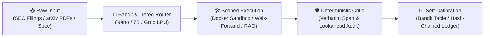

<div align="center">

<!-- Animated Typing Header -->
<a href="https://github.com/One-Hat">
  
</a>

<!-- Social & Contact Badges -->
<p align="center">
  <a href="https://github.com/One-Hat">
    
  </a>
  <a href="mailto:swapnil7x@gmail.com">
    
  </a>
  <a href="https://linkedin.com/in/">
    
  </a>
  
</p>

<!-- Hero GIF Banner -->


<br />

<sub><i>"Monolithic prompts hallucinate. Deterministic schemas, adversarial critics, and self-calibrating loops ship."</i></sub>

</div>

---

### 🧠 `whoami` // Neural Telemetry

```yaml
engineer: "Swapnil (@One-Hat)"
primary_domains:
  - Agentic LLM Architectures: "LangGraph StateGraphs, Multi-Armed Bandit Routers, Self-Calibrating Swarms"
  - Deep Learning & Continual Learning: "PyTorch, Neuromorphic ALIF/Benna-Fusi Synapses, YOLOv9 + ByteTrack"
  - Grounded AI & Fine-Tuning: "Zero-Hallucination Verifiers, Adaptive RAG, LoRA / PEFT (Gemma, Qwen, Nemotron)"
supporting_stack:
  - DevOps & Sandboxing: "Docker Sandbox Execution, GitHub Actions Matrix CI, LiteLLM Cost & Budget Guards"
  - Full-Stack & Cryptography: "Next.js, React, TypeScript, Framer Motion, FastAPI, Streamlit, ZKP / WebCrypto"
```

---

### 🏆 Flagship Engineering Spotlight

<table width="100%">
  <tr>
    <td width="50%" valign="top">
      <h3 align="left">🔮 <a href="https://github.com/One-Hat/Albus">ALBUS — Quant Research Copilot & Forecasting Swarm</a></h3>
      <p>Autonomous quant research copilot built on <b>NVIDIA Nemotron 3 (Nano 30B, Super 120B, Ultra 550B)</b>. Extracts signals from SEC EDGAR filings (Item 1A) with verbatim substring verification, runs walk-forward historical backtests with strict zero-lookahead guarantees, aggregates an 8-persona self-calibrating forecasting swarm in a SHA-256 hash-chained ledger, and subjects every thesis to an adversarial Ultra critic agent.</p>
      <p>
        
        
        
        
      </p>
    </td>
    <td width="50%" valign="top">
      <h3 align="left">⚡ <a href="https://github.com/One-Hat/Zeus">ZEUS (Forge) — Autonomous Web App Synthesis</a></h3>
      <p>Multi-LLM software synthesis pipeline orchestrated with <b>LangGraph</b>, <b>LiteLLM</b>, and an <b>epsilon-greedy contextual bandit router</b>. Transforms a single-sentence idea into an OpenAPI/DDL spec, dispatches Backend (FastAPI/SQLite), Frontend (SPA), and ML workers, executes tests inside an isolated <b>Docker sandbox</b> with up to 3 self-healing Fixer loops, and evolves prompt arms via TextGrad/DSPy-style reviewer feedback.</p>
      <p>
        
        
        
        
      </p>
    </td>
  </tr>
  <tr>
    <td width="50%" valign="top">
      <h3 align="left">🧠 <a href="https://github.com/One-Hat/GEN_AI">AXIOM — Deep Academic Research & Citation Agent</a></h3>
      <p>Six-node multi-agent research pipeline that dissects scientific PDFs per section using local 7B/8B models (<b>Ollama / vLLM</b>), mines unstated methodological weaknesses, verifies every claim against verbatim paper spans (0% hallucination gate), and maps subfield topology using <b>Semantic Scholar citation intents</b>, <b>SPECTER2 / BGE embeddings</b>, and <b>NetworkX</b>—paired with a polychromatic React + Framer Motion workspace.</p>
      <p>
        
        
        
        
      </p>
    </td>
    <td width="50%" valign="top">
      <h3 align="left">🧬 <a href="https://github.com/One-Hat/COGNX_2">MNEMA — Edge Continual Learning Architecture</a></h3>
      <p>Biologically grounded, event-driven continual learning framework that eliminates catastrophic interference without dense backbone pre-training. Combines sparse orthogonalization ($k$-WTA), address-and-accumulate associative memory, an <b>Adaptive Leaky Integrate-and-Fire (ALIF)</b> slow cortex with 4-variable <b>Benna–Fusi complex synapses</b>, sparse sleep replay, and hardware-audited energy instrumentation (<b>5.59× lower inference energy</b> on 45nm ASIC projections).</p>
      <p>
        
        
        
        
      </p>
    </td>
  </tr>
  <tr>
    <td width="50%" valign="top">
      <h3 align="left">🤖 <a href="https://github.com/One-Hat/Agentic_Ai_Dump">Self-Correcting Adaptive RAG Agent</a></h3>
      <p>Cyclical <b>LangGraph</b> agent powered by <b>Groq LPU inference (Qwen 3.8 27B)</b> and local <b>ChromaDB</b> vector embeddings. Autonomously grades retrieved document relevance, rewrites weak queries, triggers live DuckDuckGo/Wikipedia fallback search, and runs a post-generation hallucination self-correction loop with live trace inspection in Streamlit.</p>
      <p>
        
        
        
        
      </p>
    </td>
    <td width="50%" valign="top">
      <h3 align="left">👁️ <a href="https://github.com/One-Hat/Comp_vision_">YOLOv9 Vision Tracking</a> & <a href="https://github.com/One-Hat/JEE-NEET_ModeL">LoRA Gemma-2B</a></h3>
      <p><b>Computer Vision & PEFT Lab:</b> Production <b>YOLOv9 + PyTorch + ByteTrack</b> multi-object detection and tracking pipeline with frame telemetry & JSON/CSV reporting, alongside a parameter-efficient <b>LoRA fine-tuned Google Gemma-2B-IT</b> model (<code>r=8, alpha=16</code> on <code>q_proj, v_proj</code>) specialized for STEM problem synthesis.</p>
      <p>
        
        
        
        
      </p>
    </td>
  </tr>
</table>

> 🔐 **Also Built:** [**MEDVAULT_DID**](https://github.com/One-Hat/MEDVAULT_DID) — Decentralized healthcare identity & verifiable consent platform using **Next.js**, **TypeScript**, **Web Crypto API (NIST P-256 / AES-GCM)**, **Hyperledger Aries (`did:peer`)**, and **AnonCreds Zero-Knowledge Predicate Proofs (ZKP)**.

---

### ⚡ Tech Stack Mastery

#### 🤖 1. LLMs, Agentic Systems & RAG *(Core Specialization)*
<p align="left">
  
  
  
  
  
  
  
  
</p>

#### 🔬 2. Deep Learning, Computer Vision & Quantitative ML
<p align="left">
  
  
  
  
  
  
  
  
</p>

#### ⚙️ 3. DevOps, MLOps & Frontend Engineering
<p align="left">
  
  
  
  
  
  
  
  
</p>

---

### 🏗️ Architectural Design Pattern Across My Repos



---

### 📊 GitHub Telemetry & Contribution Velocity

<div align="center">
  
  
</div>

<div align="center">
  
</div>

<div align="center">
  
</div>

---

<div align="center">
  
  <p><sub>⚡ Architected by <b>Swapnil (@One-Hat)</b> — Grounded LLMs, Autonomous Swarms & Deep Learning</sub></p>
</div>
